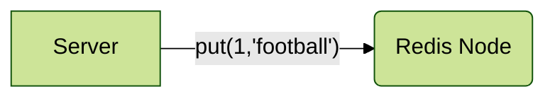
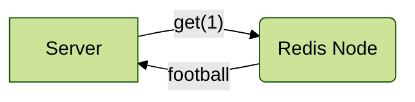
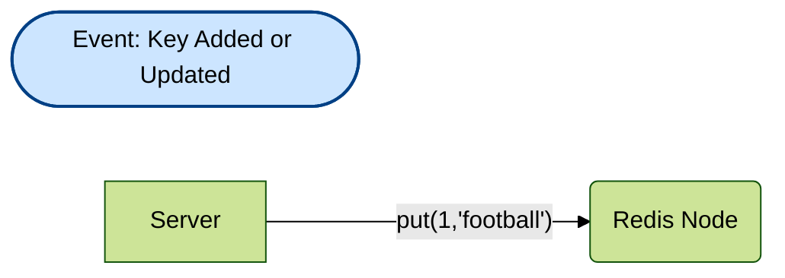
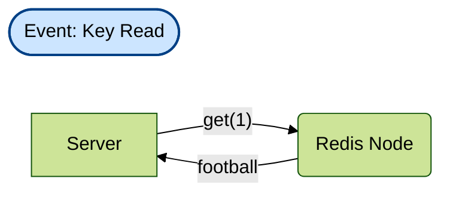

# System design for 'redis'

Design a distributed key value store such as Redis, Memcached.

# Functional Requirements

- put(key, value) - insert 'value' associated with 'key'
- get(key) - get 'value' associated with 'key'

# Non Functional Requirements

- Data size - max 10 KB per key-value pair
- Ability to store big data
- High availability - The system responds quickly, even during failures
- High scalability - The system can be scaled up to support large dataset
- Automatic scaling: The addition/deletion of servers should be automatic based on traffic.
- Tunable consistency.
- Low latency.

# Actors Actions

# Event Storming

