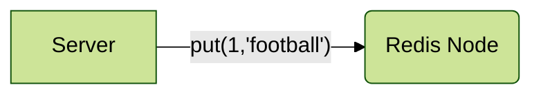
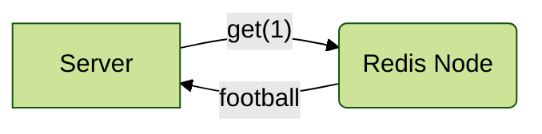
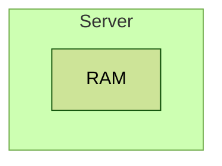
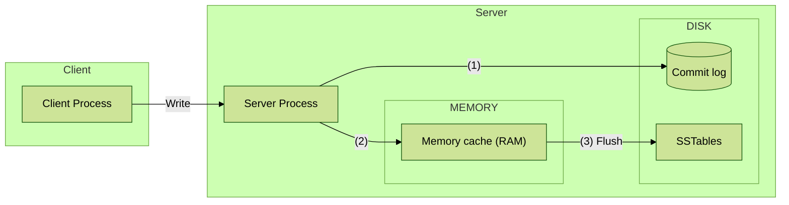
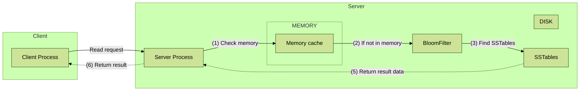
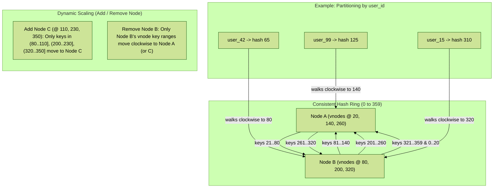
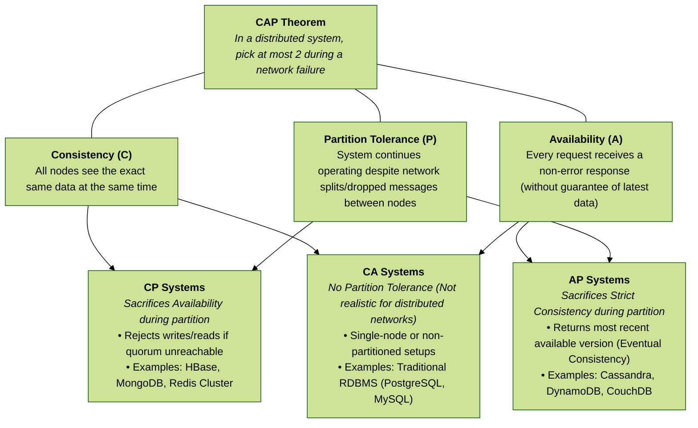
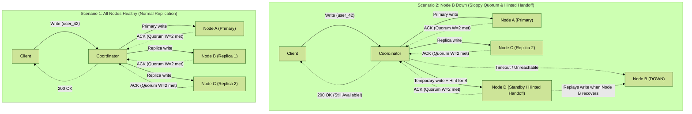
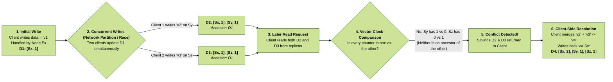
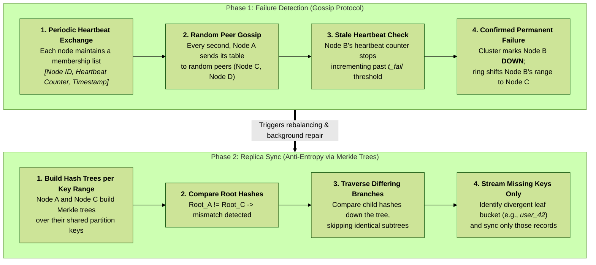

# System design for 'redis'

Design a distributed key value store such as Redis, Memcached.

# Functional Requirements

- put(key, value) - insert 'value' associated with 'key'
- get(key) - get 'value' associated with 'key'

# Non Functional Requirements

- Data size - max 10 KB per key-value pair
- Ability to store big data
- High availability - The system responds quickly, even during failures
- High scalability - The system can be scaled up to support large dataset
- Automatic scaling: The addition/deletion of servers should be automatic based on traffic.
- Tunable consistency.
- Low latency.

# Actors Actions

# Event Storming

# Components

# Characteristics

# Components revisited for performance

## Write flow

## Read flow

# Components revisited for scalability

## Data partitioning using consistent hashing

- Distribute data evenly
- Minimize data movement when adding or removing nodes.

# Components revisited for high availability

## CAP Theorem

## Data replication and data consistency

## Data inconsistency handling

## Handling permanent failure

